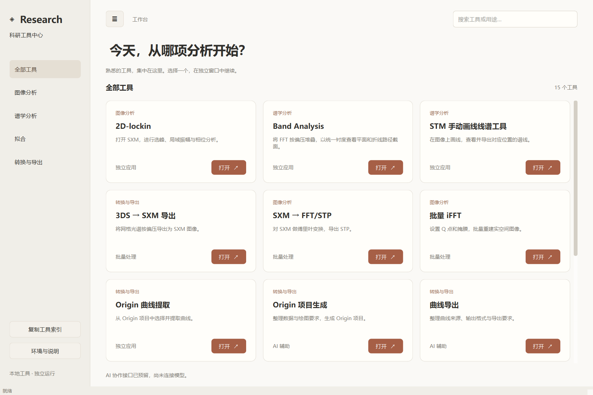

# STM Research Toolkit

面向 STM/STS 的桌面科研工具集，**比较适用于二维材料的结构分析与电子态分析**。将形貌、傅里叶与锁相分析、网格光谱、数据转换和拟合工具放在同一个入口，保持各模块独立。

A Windows-first desktop toolkit for STM/STS, especially structural and electronic-state analysis of two-dimensional materials.



## 安装与启动

下载仓库 ZIP 后完整解压到可写目录，或运行：

```powershell
git clone https://github.com/genius-FXC/stm-research-toolkit.git
cd stm-research-toolkit
```

1. 双击 **`Install.bat`**：检查 64 位 Python 3.11+，在仓库内建立 `.venv`，安装依赖并检查环境。没有 Python 时，尝试通过 Windows `winget` 安装 Python 3.12。需要联网，可能显示安装许可提示。
2. 双击 **`Start.bat`**：打开桌面工具中心。工具保留独立窗口；线谱工具使用桌面内的本地视图，不跳转外部网站。
3. 遇到问题运行 **`Check.bat`**，它会区分核心依赖缺失与可选软件未配置。

不包含原作者电脑的 Python 环境、绝对数据路径、实验文件、输出结果、聊天记录或 API 密钥。**不要复制 `.venv` 到另一台电脑**；复制整个仓库后重新运行安装即可。Qt/WebEngine 依赖较大，首次安装需要下载数百 MB。

如果没有 winget，请从 [Python 官网](https://www.python.org/downloads/windows/) 安装 64 位 Python（包含 Tcl/Tk 与 pip），再运行安装器。已有 Python 可直接运行 `powershell -NoProfile -ExecutionPolicy Bypass -File .\setup.ps1`，不会安装系统 Python。

手动安装：

```powershell
python -m venv .venv
.\.venv\Scripts\python.exe -m pip install -r requirements.txt
.\.venv\Scripts\python.exe scripts\configure.py
.\.venv\Scripts\python.exe scripts\doctor.py
.\.venv\Scripts\python.exe app\main.py
```

依赖版本采用兼容范围；`docs/VALIDATION.md` 记录本次实际测试版本。安装脚本可重复运行，保留已有本地配置。下载或安装失败会明确报错；修复网络后重试，不需要改系统 Python 的依赖。

## 工具与边界

| 工具 | 使用方式 | 额外要求 |
| --- | --- | --- |
| 2D-lockin（原 STM Fourier Analyzer） | 独立 GUI；SXM、FFT、Bragg、Gaussian mask、局域相位/振幅、iFFT | Python/Tk |
| Band Analysis | 独立 GUI；FFT 体数据、q–E 截面与峰拟合 | Qt、OpenGL/显卡驱动 |
| STM 手动画线线谱工具 | 桌面本地视图；3DS、AB 线、旋转、线谱及导出 | Python、QtWebEngine |
| 3DS → SXM | 入口内批量任务面板 | Python |
| SXM → FFT/STP | 入口内批量任务面板 | Python |
| 批量 iFFT | 入口内批量任务面板，配置 Q 点、半径和输出 | Python |
| Origin 曲线提取 | MATLAB GUI | MATLAB、Origin、Windows COM |
| Kondo 拟合 | MATLAB GUI，Hurwitz/Frota-Fano | MATLAB、Optimization Toolbox |
| Ternes 自旋激发拟合 | Scilab GUI/脚本，由使用者配置模型与数据 | Scilab；打开程序不代表已经拟合 |
| Origin 项目生成 | 线谱工具导出或脚本 | Origin、originpro/OriginExt |
| 曲线导出 | 对应工具的导出功能或 MATLAB 函数 | 依赖曲线来源 |
| 峰位、二阶导数、能隙、周期性分析 | 入口内上下文面板和已有分析模板 | 需准备数据、区域/上游结果并核对参数 |

最后一组是 `research_quicklooks` 中的**特定数据流程模板**，不是适用于任意数据的全自动分析器。保留原算法和参数约束；使用者或 AI 需要按自己的数据调整输入、区域、峰定义和单位。缺少上游数据时不可直接运行。详见 [分析模板](docs/ANALYSIS_TEMPLATES.md)。不包含历史实验结果和一次性的拟合报告/维护脚本。

## MATLAB、Scilab 与 Origin

这些软件不随仓库分发，也不会由安装器自动购买或安装。首次配置会尝试从 PATH 找到 MATLAB/Scilab；其他情况编辑本地 `registry/machine.json`，填写本机可执行文件的完整路径。该文件被 Git 忽略，示例在 `registry/machine.example.json`。

Origin 导出另安装 Python 接口：

```powershell
powershell -NoProfile -ExecutionPolicy Bypass -File .\setup.ps1 -WithOrigin
```

这只安装 Python 接口，不安装 Origin 本体，也不保证任意 Origin/Python 版本兼容。Kondo 和 Ternes 保留第三方模型来源及许可，见 [第三方说明](THIRD_PARTY_NOTICES.md)。

## 独立运行与扩展

在仓库根目录运行：

```powershell
.\.venv\Scripts\python.exe modules\2d-lockin\app.py
.\.venv\Scripts\python.exe modules\band_analysis\app.py
.\.venv\Scripts\python.exe app\main.py --open line-spectrum
.\.venv\Scripts\python.exe adapters\batch_runner.py path\to\job.json
```

批量任务通过入口填写输入/输出/参数；输出必须是独立的新目录，不能覆盖原始数据。工具索引在 `registry/tools.json`；新模块放入 `modules/<id>`，新增入口适配，不改已有工具的科学计算。

## AI 接口与数据

常规转换、FFT、线谱和拟合计算不需要 AI。工具中心的 `adapters/agent_bridge.py` 只定义轻量 Agent/Auth 接口和本地会话格式，**没有接入统一 AI API/OAuth，也不能导入 Codex 历史对话**。

2D-lockin 自身保留可选的 OpenRouter AI 分析功能：只有自行配置密钥并主动点击 AI 分析时才调用；这会向配置的服务发送当前视图及分析上下文。API 费用和服务账号由使用者负责。密钥放本地环境变量或被忽略的 `.env` 文件，切勿提交到仓库。

## 验证与适用平台

桌面整合目前以 Windows 为目标；Python 数值核心不等于完整桌面跨平台支持。测试仅验证实现一致性，不代替对真实科研结果的物理审查。详见 [验证记录](docs/VALIDATION.md)。

```powershell
.\.venv\Scripts\python.exe tests\verify_core.py
Push-Location modules\2d-lockin
..\..\.venv\Scripts\python.exe -m unittest discover -s tests -v
Pop-Location
```

第三方模块按各自许可提供。仓库中其余原创部分目前尚未指定统一开源许可证；公开可访问不意味着所有文件可按同一种许可再分发。
